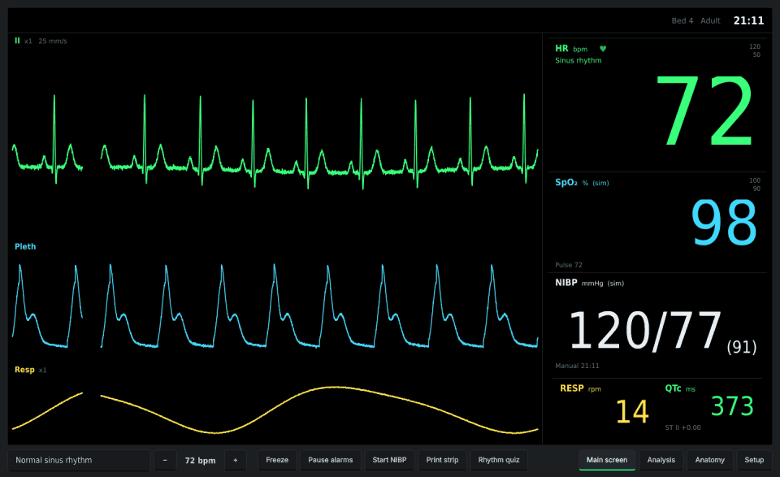
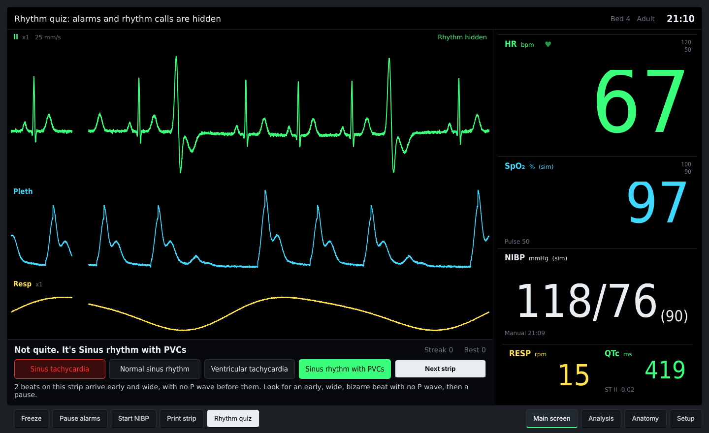
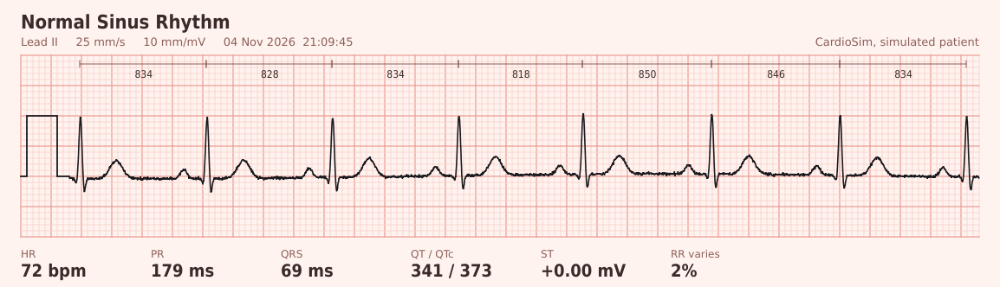
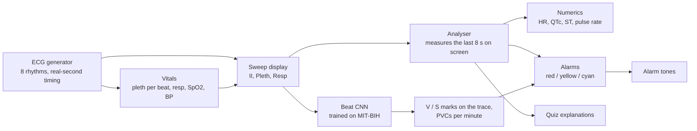

# CardioSim

**A bedside patient monitor you can teach with.** A simulated patient runs on a monitor modelled on real ICU equipment, with lead II ECG, SpO₂ pleth and respiration sweeping across a black screen. Every number is measured from the waveform, every beat is labelled by a neural network trained on real patients' ECGs, and the alarms go off when the analysis catches something.




[](https://github.com/Janat-Yasser/heart_simulator/actions/workflows/ci.yml)


> Educational simulator, **not a medical device**. Don't use it for diagnosis.

## Why it's interesting

- **The monitor reads the strip; it isn't told the answer.** A rule-based analyser finds each QRS and measures rate, regularity, P waves, PR, QRS width, ST and QTc, the way a clinician reads a strip. Alarms come from those measurements, so they lag a few seconds behind a rhythm change, just as a real monitor's do. It calls all 8 simulated rhythms correctly across rates, noise levels and seeds (checked in the test suite).
- **A beat classifier trained on real ECGs.** A small 1-D CNN, trained on the MIT-BIH Arrhythmia Database, labels every beat on screen and marks ectopic ones over the trace: **V** for a PVC, **S** for a premature atrial beat. It drives the "PVCs n/min" alarm. It was tested the strict way, on 22 patients it never saw: it catches 91% of ventricular beats (90% of its V calls are right) and 97% of normal ones. It also labels the simulator's own beats correctly: every 4th beat of the PVC rhythm, and every beat of VT.
- **The pulse follows the heart.** The pleth wave gets one pulse per beat. A premature ventricular beat arrives before the ventricle has filled, so its pulse is weak. That's why, with PVCs, the oximeter's pulse rate reads lower than the ECG heart rate (the *pulse deficit*). In VT the pleth nearly flattens.
- **It behaves like the real thing.** Red/yellow/cyan alarm priorities with `***`/`**`/`*` markers and IEC 60601-1-8 style tone patterns, a two-minute audio pause, a QRS beep whose pitch drops as SpO₂ falls, a manual blood-pressure cuff that inflates and deflates, and a freeze key.
- **It teaches.** There's a rhythm quiz that hides the rhythm and the alarms, plays a random strip and explains the answer from what was measured on *that* strip. You can also print a strip on ECG paper.

| Rhythm quiz | Printed strip |
|---|---|
|  |  |

## How it fits together



## Quick start

```bash
git clone https://github.com/Janat-Yasser/heart_simulator.git && cd heart_simulator
pip install -r requirements.txt
python main.py
```

Keys: **F** freeze, **Space** pause alarm audio for 2 minutes, **N** start the blood-pressure cuff, **P** print a strip, **Q** rhythm quiz.

<details>
<summary>Rhythms</summary>

| Rhythm | What you'll see |
|---|---|
| Normal sinus | Regular, 60–100 bpm, a P before every QRS |
| Sinus bradycardia | Under 50 bpm |
| Sinus tachycardia | Over 125 bpm, narrow QRS |
| Atrial fibrillation | Irregularly irregular RR, wavy baseline, no P waves; pulse strength varies beat to beat |
| PVCs | An early, wide beat every 4th, then a pause; weak pulse on the early beat |
| 1st-degree AV block | PR around 300 ms at a normal rate |
| Ventricular tachycardia | Wide QRS over 150 bpm; red alarm, pleth nearly flat, SpO₂ falls |
| STEMI | ST segment raised after every QRS |

</details>

<details>
<summary>How the analysis measures a strip</summary>

`ai/classifier.py`:

| Feature | How it's measured |
|---|---|
| Heart rate / RR | R-peak detection with a 200 ms refractory period (works to about 300 bpm) |
| QRS width | QRS onset to offset, where the slope drops below 12% of its peak |
| P wave and PR | Largest deflection up to 350 ms before the QRS, then P onset to QRS onset |
| ST level | Against the PR baseline at J+60 ms (J+40 ms above 100 bpm). Not assessed above 150 bpm, or on wide complexes |
| QT / QTc | QRS onset to T end (tangent method), Bazett-corrected |

Textbook criteria then decide the rhythm. The percentage on the Analysis page is a **rule margin**, meaning how far the features sit past the deciding threshold. It isn't a calibrated probability.

The generator (`core/ecg_generator.py`) times every wave in real seconds around each R peak, so QT follows Bazett's formula and ventricular beats stay wide at any rate. SpO₂, respiration and blood pressure (`core/vitals.py`) are simulated per rhythm and labelled "(sim)" on screen.

</details>

<details>
<summary>Sound</summary>

Everything is synthesised. To use recordings instead, put `heartbeat.wav`, `beep.wav` or `alarm.wav` in `assets/sounds/` (see `assets/sounds/README.txt` for free CC0 sources). Under Setup you can pick QRS tone, heart sounds, both or silent, and turn off the SpO₂-following pitch.

</details>

<details>
<summary>Tests</summary>

```bash
pip install pytest
pytest
```

84 tests: every rhythm across several heart rates, noise levels and seeds; heart rate accuracy up to 220 bpm; QTc, PR and QRS measurements; the pulse deficit; alarm ranking; quiz questions and explanations; and the trained beat classifier on simulated rhythms.

</details>

<details>
<summary>The beat classifier and how it was trained</summary>

```bash
pip install wfdb jax optax
python train_beats.py                       # downloads MIT-BIH from PhysioNet (~100 MB)
python train_beats.py --data path/to/mitdb  # or point it at a local copy
```

- **Input:** 0.6 s of lead II around each R peak (resampled to 360 Hz, band-passed, normalised per beat), plus five timing features: how early the beat came, how long the pause after it was, and the local rhythm.
- **Network:** three 1-D convolutions, global average pooling, then two dense layers with the timing features. About 9,000 weights. Trained in a couple of minutes on a CPU with JAX; the monitor runs it in plain NumPy (`ai/beat_model.py`), so it needs no deep-learning library.
- **Evaluation:** the standard inter-patient split (de Chazal 2004). It trains on 22 patients (DS1) and is tested on 22 others (DS2), never mixing a patient's beats across the two. Paced records are excluded. Labels are the AAMI classes N, S, V and F.

| Class (test patients) | Beats | Caught (sensitivity) | Right when it says so (PPV) |
|---|---|---|---|
| N normal | 44,217 | 97% | 95% |
| S supraventricular | 1,836 | 13% | 35% |
| V ventricular | 3,219 | 91% | 90% |
| F fusion | 388 | 2% | 1% |

Data: MIT-BIH Arrhythmia Database (Moody and Mark, 2001), from PhysioNet (Goldberger et al., 2000), under the ODC Attribution License.

Overall accuracy is 92.9%, but that's mostly normal beats. S and F beats look almost normal on a new patient. They are the classes published inter-patient models struggle with too, and this one doesn't solve them. The monitor uses its V calls, which are reliable.

</details>

<details>
<summary>Project layout</summary>

```
main.py               the monitor window: sweep, numerics, alarms, NIBP, quiz, strips
core/ecg_generator.py ECG generator, 8 rhythms
core/vitals.py        pleth, respiration, simulated SpO2 / BP
core/alarms.py        alarm rules and priorities
core/quiz.py          quiz questions and explanations
ai/classifier.py      rule-based rhythm analyser
audio/sound_engine.py synthesised tones and alarm patterns
ui/monitor.py         sweep channels, parameter boxes, alarm bar
ui/strip.py           printable ECG-paper strip
ui/widgets.py         analysis panel, conduction diagram
ui/heart_page.py      3D heart (OpenGL) or 2D cross-section
ai/beat_model.py      MIT-BIH-trained beat CNN (NumPy inference)
train_beats.py        trains it (JAX), writes ai/beat_cnn.npz
```

</details>

## Roadmap

- Better supraventricular-beat detection (longer RR context, patient-adaptive normalisation)
- Validate the analyser on real MIT-BIH strips, not only simulated ones
- 2nd- and 3rd-degree AV block, atrial flutter
- Adjustable alarm limits per patient profile (adult, child)

© 2026 Janat Yasser. All rights reserved. See [LICENSE](LICENSE).